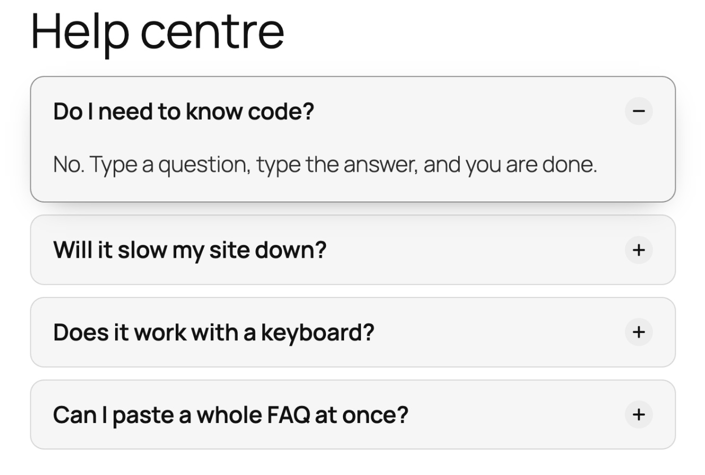

# Clear FAQ Block

**A FAQ accordion for the block editor that's quick to fill in and light on your site.**



## Why it's nice to use

- **Paste a whole FAQ at once.** Copy questions and answers from a doc, paste them into *Paste a list*, and each pair becomes an item. Put the question on the first line and the answer below it, with a blank line between pairs.
- **Edit in place.** Every question and answer is editable right in the block. Move, duplicate or remove items with the buttons that appear on hover.
- **Three designs.** *Cards*, *Lines* or *Minimal*, picked from visual thumbnails, plus an accent colour from your theme palette.
- **No front-end JavaScript.** It's built on the browser's own `<details>` and `<summary>` elements, so it loads nothing extra. It also works with a keyboard and screen readers out of the box.
- **One answer open at a time** (optional). This uses the native `name` attribute, and each block gets its own group so two FAQs on a page never interfere.
- **Smooth opening** in browsers that support animating to `auto` height. Other browsers open instantly. It respects *reduced motion*.
- **FAQ schema built in.** It adds one combined `FAQPage` JSON-LD block per page. Switch it off per block if your SEO plugin already handles it.

> Google currently shows FAQ rich results mainly for government and health sites. The schema still helps search engines and AI assistants understand the page.

## Install

1. Download the latest release ZIP, or clone this repository and run `npm install && npm run build`.
2. Upload it in **Plugins → Add New → Upload Plugin** and activate it.
3. In the editor, add the **Clear FAQ** block.

Requires WordPress 6.6+ and PHP 7.4+.

## Development

```bash
npm install
npm start        # watch mode
npm run build    # production build into /build
```

```
src/block.json   Block metadata and attributes
src/edit.js      Editor UI (React): items, sidebar, paste import
src/save.js      Saved markup (<details>/<summary>)
src/style.scss   Front end and editor styles
src/editor.scss  Editor-only styles
clear-faq-block.php  Registers the block, adds group names, prints the schema
```

Filter the schema before it's printed, or return an empty array to skip it:

```php
add_filter( 'clear_faq_block_schema', function ( $schema ) {
	return $schema;
} );
```

## License

GPL-2.0-or-later. Built by [Rohan Salave](https://www.linkedin.com/in/rohan-salave-362475189/).
